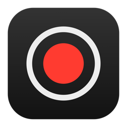
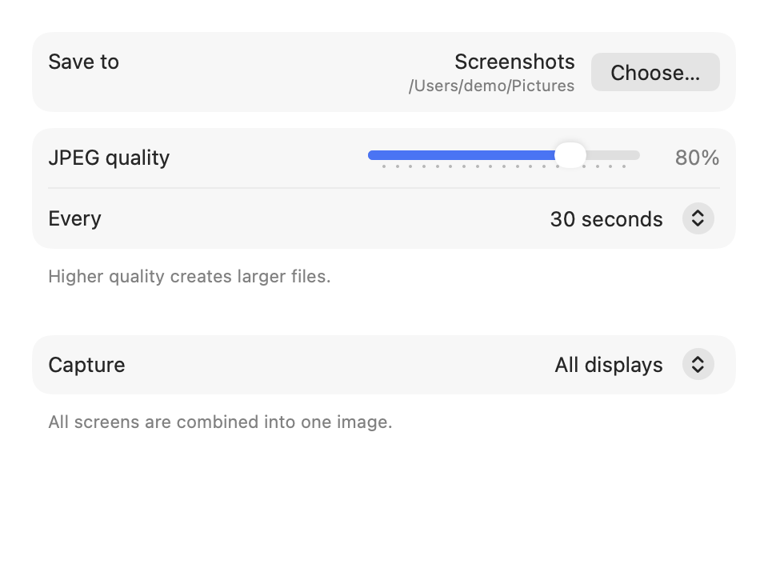

<p align="center">
  
</p>

<h1 align="center">InstantShot</h1>

<p align="center">
  A tiny macOS menu-bar app that quietly saves a screenshot of your whole desktop every few seconds,<br>
  so you can scroll back through your day.
</p>

---

<!-- Screenshot placeholders: menu + stitched demo capture are added before publishing. -->

<p align="center">
  <picture>
    <source media="(prefers-color-scheme: dark)" srcset="docs/images/settings-dark.png">
    
  </picture>
</p>

## What it does

- **Captures on a schedule.** Every 5 seconds to 1 hour (30 seconds by default), it saves one JPEG.
- **All your screens in one image.** With several displays, they're stitched together exactly as arranged in
  System Settings › Displays, each at full native resolution. Or capture just the main display.
- **Stays out of the way.** A small ring in the menu bar fills red while capturing. Hover it for the status.
  It starts capturing as soon as it launches once a save folder is set.
- **Tidy files.** Screenshots go into one folder per day, named by time:

  ```
  Screenshots/
    261102/
      261102-143022.jpg
      261102-143052.jpg
  ```

## Requirements

- A Mac with Apple silicon, macOS 14 or later
- Apple's Command Line Tools (`xcode-select --install`); full Xcode is not needed

## Build and run

```sh
git clone <this repo>
cd instantshot
./build.sh
open build/InstantShot.app
```

On first Start, macOS asks for **Screen Recording** permission
(System Settings › Privacy & Security › Screen & System Audio Recording). Allow it, then press Start again.

### Optional: a stable signature

By default the app is signed ad-hoc, which gives each build a new identity, so macOS may ask for
Screen Recording permission again after every rebuild. To avoid that, create a self-signed
code-signing certificate once and tell the build to use it:

1. Keychain Access › Certificate Assistant › Create a Certificate…
   Name it (for example `My Code Signing`), Identity Type **Self-Signed Root**, Certificate Type **Code Signing**.
2. Put that name in a file called `.signing-identity` next to `build.sh` (it's git-ignored),
   or set `INSTANTSHOT_SIGN_IDENTITY` in your environment.
3. Run `./build.sh` in Terminal and click **Always Allow** when macOS asks to use the key.

## Using it

| Menu item | What it does |
| --- | --- |
| Start / Stop Capture `⌘S` | Toggles capturing. The subtitle shows when the last screenshot was saved. |
| Show in Finder | Opens your save folder. |
| Settings… `⌘,` | Save folder, JPEG quality, interval, and which displays to capture. Changes apply instantly. |
| Quit InstantShot `⌘Q` | Quits. |

**Disk use:** at 30-second intervals that's about 2,880 images a day. With two large displays at quality 60,
each image is roughly 2.7 MB, so plan for several GB per day. Lower the quality or lengthen the interval to save space.

## How it works

One Swift file (`Sources/main.swift`), no dependencies:

- **ScreenCaptureKit** captures each display as a still image.
- **Core Graphics** stitches multiple displays onto one canvas using their arrangement from macOS.
- **ImageIO** writes the JPEG.
- **AppKit** runs the menu-bar item, and **SwiftUI** draws the Settings form.
- Settings live in `UserDefaults`.

`build.sh` compiles with `swiftc`, assembles the `.app` bundle, and signs it.
The icon is drawn by `tools/make-icon.swift`.

## License

See [LICENSE](LICENSE).
